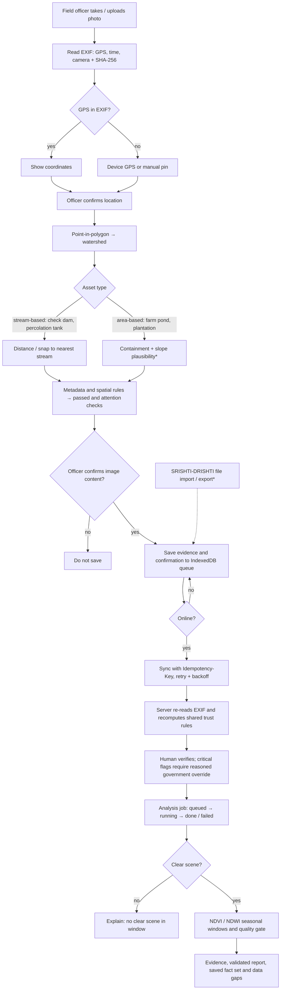

# Architecture — Built vs Planned

Last updated: 20 Oct 2026

## Built (in this repo, runs today)

```
React 19 PWA (Vite, TS)
 ├─ UI → services → Express API (Bearer Supabase JWT)
 ├─ shared/trustRules.ts is previewed in the browser and authoritatively run on the server
 ├─ IndexedDB sync stores preliminary observations; server results replace previews
 └─ watershed-scoped evidence and server-generated, auditable reports
Express + TypeScript + PostgreSQL/PostGIS (local Docker Compose)
 ├─ JWT/JWKS auth; officers/government admins resolved with caller JWT + anon key
 ├─ PostGIS stores spatial evidence, typed provenance, verification, jobs and reports
 ├─ GET /health probes a PostGIS geometry operation, not just database connectivity
 ├─ evidence queries are scoped by watershed_id in SQL
 ├─ local photo files; database stores relative path and recomputed SHA-256
 └─ Python satellite worker claims typed jobs with SKIP LOCKED and writes measurements
Supabase = identity and officer/admin records; PostGIS = evidence and spatial data
```

| Capability | Where | Notes |
|---|---|---|
| Point-in-watershed at upload | `src/services/spatialService.ts` → PostGIS `ST_Covers`; mock/offline uses `src/utils/geo.ts` | smallest overlapping watershed wins; boundary points count as inside |
| Stream snap (stream-based assets) | `src/services/spatialService.ts` → PostGIS geography `ST_DWithin` / `ST_ClosestPoint`; mock/offline uses `src/utils/geo.ts` | snapped point stored separately; original confirmed location kept |
| Evidence checks | `shared/trustRules.ts`, `server/verification.ts`, `src/components/evidence/TrustPanel.tsx` | server recomputes EXIF/spatial/history rules; pixels are not classified; clean results remain pending human review |
| Offline sync | `src/services/offlineStore.ts`, `src/services/syncService.ts` | pending/syncing/synced/failed/rejected, backoff 5 s → 5 min, Idempotency-Key |
| Watershed evidence | `server/evidence.ts`, `src/hooks/useWatershedEvidence.ts` | typed sections include source/license/demo provenance; SQL is watershed-scoped |
| Reports | `server/report/*`, `server/reportValidator.ts`, `shared/reportFacts.ts` | deterministic fact IDs, code-generated gaps, validated claims and saved fact-set hash |
| Satellite analysis | `server/satellite/windows.ts`, `scripts/satellite/*` | seasonal jobs, Sentinel-2 L2A SCL mask, AOI statistics and 60% coverage gate |
| Pilot summary | `api/pilot-summary.ts`, `src/services/aiService.ts` | optional server-only AI gateway key; unrelated to photo verification |
| Real boundaries | `src/components/maps/WatershedMap.tsx` (`pmtiles://`) + `scripts/prepare_watersheds` | off until env var set |

## Remaining limitations

| Capability | Status | Notes |
|---|---|---|
| Verified operational datasets | Not bundled | Watersheds/assets/seed measurements remain demo; real imports require reviewed provenance and licensing |
| Production deployment and storage | Not provided | Compose credentials and filesystem photo storage are local-development settings |
| Rainfall normalization | Not implemented | Reports disclose this gap; satellite differences are not causal impact estimates |
| Official workflows | Not integrated | SRISHTI-DRISHTI and production identity provisioning require deployment work |
| Photo content classifier | Not implemented | EXIF and spatial rules cannot prove what an image depicts |

### Data API routes expected under `/api/v1`

All routes except public `GET /health` require a valid Supabase JWT. The API
also provides `GET /watersheds/:id/evidence`, `GET /watersheds/:id/satellite`,
`POST /watersheds/:id/report`, `GET /watersheds/:id/reports`,
`GET /reports/:reportId`, and `POST/PATCH /interventions`. Other routes include
`GET/POST /watersheds`, `GET /layers`, `GET/POST /assets`, `GET/POST /uploads`
(`Idempotency-Key` header), `PATCH /uploads/{id}/verify`, `POST /analytics`,
`GET /analytics/jobs`, `GET /analytics/jobs/:id`, `GET /analytics/results`,
`GET /interventions`, `GET /reports`, `GET /users/me`, `GET /users/team`,
`GET/POST /streams`, and `GET /satellite/timeline`. Spatial endpoints:
`GET /spatial/resolve-watershed?longitude=…&latitude=…` and
`GET /spatial/snap-to-stream?longitude=…&latitude=…&watershedId=…`.
`pnpm db:setup` applies ordered idempotent migrations and seeds illustrative
demo rows. `pnpm db:backfill`, `pnpm db:seed:dev`, `pnpm db:compute-drainage`,
and `pnpm data:import-streams` support data preparation. Imported operational
rows require verified source/license information and must not be marked demo.
The API health check returns `postgis: "ready"` only after a point/SRID
operation succeeds; run `pnpm db:setup` against the API's `DATABASE_URL` to
apply the PostGIS migration and create the upload/evidence tables.

The optional pilot-summary Vercel function is separate from that planned data
API. It uses `OMNIROUTE_API_KEY` (no `VITE_` prefix), validates same-origin
requests and bodies, and has a best-effort in-memory per-instance rate limit.
It does not classify uploaded photos, persist observations, or replace the
local backend.

## Corrected app flow


This remains a prototype: source datasets, Supabase policy setup, container
registry access, and production operations must be completed for deployment.
