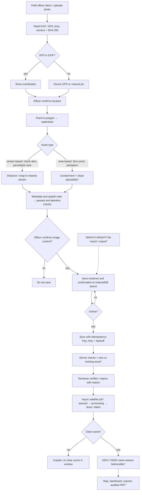

# Architecture — Built vs Planned

Last updated: 16 Oct 2026

## Built (in this repo, runs today)

```
React 19 PWA (Vite, TS)
 ├─ src/pages/        Dashboard, Map analysis, Upload, Workspace sections
 ├─ src/components/   WatershedMap (MapLibre), WatershedPanel, TrustPanel,
 │                    SyncIndicator, DemoBadge
 ├─ src/services/     hydrosnapService (mock | REST), offlineStore (IndexedDB),
 │                    syncService (queue → POST /api/v1/uploads)
 ├─ src/utils/        geo (PIP, bounds, nearest stream), trust rules, exporters
 └─ src/services/mock/mockData.ts  DEMO watersheds, assets, streams, indices
Vercel functions
 └─ /api/pilot-summary   optional AI-gateway multilingual summary from PilotAnalysis facts
Express + TypeScript + PostgreSQL/PostGIS (local Docker Compose)
 ├─ /api/v1/*             domain API consumed by hydrosnapService
 ├─ JSONB payloads        preserve the frontend domain shapes
 ├─ GiST geometry indexes for watershed boundaries, assets, observations, streams
 └─ local photo files     SHA-256 checked; database stores relative path + hash
```

| Capability | Where | Notes |
|---|---|---|
| Point-in-watershed at upload | `src/services/spatialService.ts` → PostGIS `ST_Covers`; mock/offline uses `src/utils/geo.ts` | smallest overlapping watershed wins; boundary points count as inside |
| Stream snap (stream-based assets) | `src/services/spatialService.ts` → PostGIS geography `ST_DWithin` / `ST_ClosestPoint`; mock/offline uses `src/utils/geo.ts` | snapped point stored separately; original confirmed location kept |
| Evidence checks | `src/utils/trust.ts`, `src/components/evidence/TrustPanel.tsx` | local metadata/spatial checks; photo pixels are not classified; officer confirmation is persisted |
| Offline sync | `src/services/offlineStore.ts`, `src/services/syncService.ts` | pending/syncing/synced/failed, exp. backoff 5 s → 5 min, Idempotency-Key |
| Pilot summary | `api/pilot-summary.ts`, `src/services/aiService.ts` | optional server-only AI gateway key; unrelated to photo verification |
| Real boundaries | `src/components/maps/WatershedMap.tsx` (`pmtiles://`) + `scripts/prepare_watersheds` | off until env var set |

## Planned (not built)

| Capability | Status | Notes |
|---|---|---|
| Express + PostgreSQL/PostGIS | Implemented for local development | Docker Compose, SQL migration and demo seeding, persisted uploads/assets/jobs/reports, PostGIS watershed and stream operations |
| Server trust checks, JWT roles, and managed object storage | Planned | Current spatial endpoints do not replace the user's confirmed location; authentication and remote object storage are not implemented |
| Celery + Redis satellite jobs | Planned | No production NDVI/NDWI processing worker exists |
| Satellite/terrain processing and SRISHTI-DRISHTI integration | Planned | Verify source dataset licences before importing; no production analysis pipeline is included |
| Audited PDF, Hindi/Marathi upload flow, deployment hardening | Planned | |

### Data API routes expected under `/api/v1`

`GET/POST /watersheds`, `GET /layers`, `GET/POST /assets`, `GET/POST /uploads`
(`Idempotency-Key` header), `PATCH /uploads/{id}/verify`, `POST /analytics`,
`GET /analytics/jobs`, `GET /analytics/results`, `GET /interventions`,
`GET/POST /reports`, `GET /users/me`, `GET /users/team`, `GET/POST /streams`,
and `GET /satellite/timeline`. Spatial endpoints:
`GET /spatial/resolve-watershed?longitude=…&latitude=…` and
`GET /spatial/snap-to-stream?longitude=…&latitude=…&watershedId=…`.
`pnpm db:setup` seeds illustrative demo data; imported real boundaries and
streams must have verified provenance and licence information.

The optional pilot-summary Vercel function is separate from that planned data
API. It uses `OMNIROUTE_API_KEY` (no `VITE_` prefix), validates same-origin
requests and bodies, and has a best-effort in-memory per-instance rate limit.
It does not classify uploaded photos, persist observations, or replace the
local backend.

## Corrected app flow


`*` = planned.
